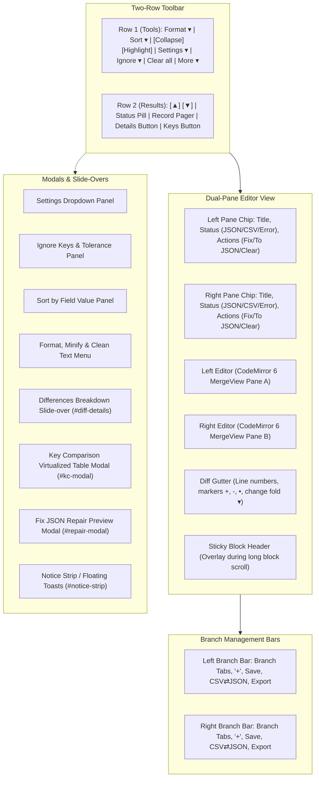
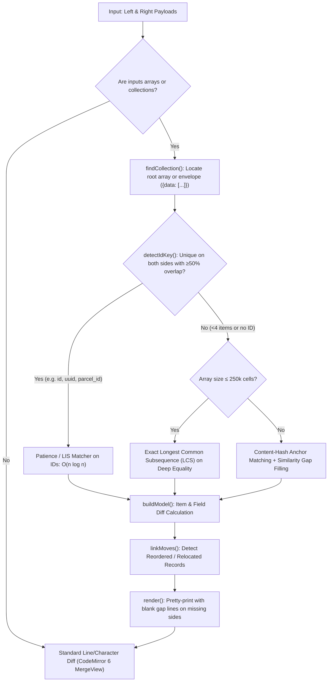
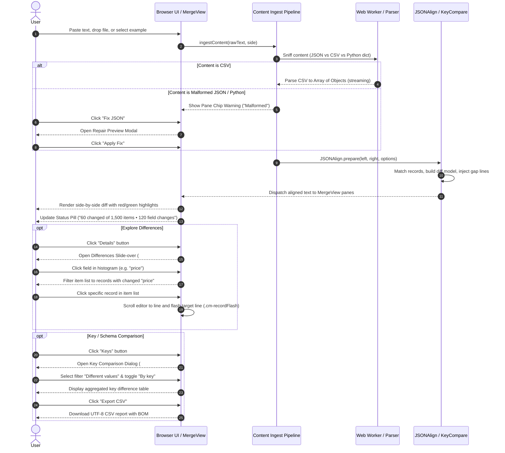
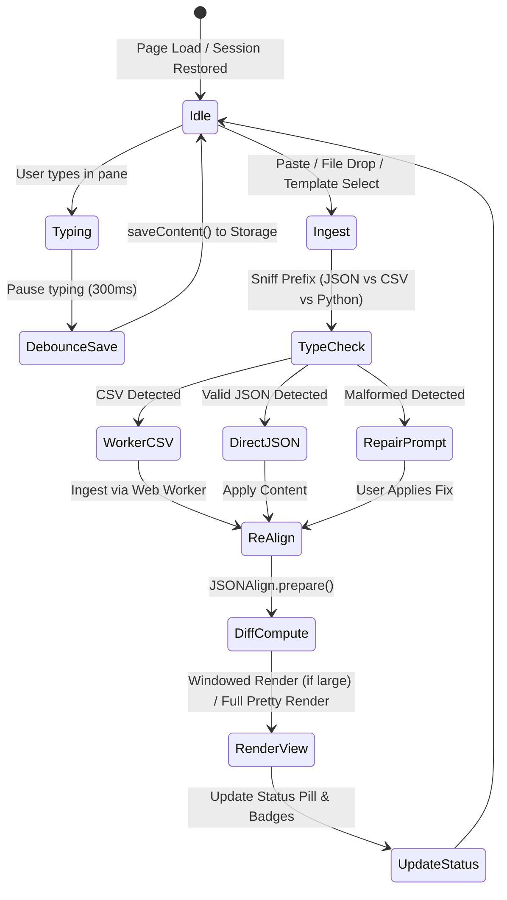

# Functional and UI Analysis of the Existing Injection Compare Tool (`json_compair`)

## Executive Overview

This document presents a comprehensive functional and UI analysis of the existing comparison tool (implemented in the `json_compair` repository, specifically the modern `v6` CodeMirror 6 architecture). The analysis extracts its user-facing behavior, comparison workflows, information architecture, difference presentation, and interaction patterns.

The existing tool serves as a functional and UX benchmark. In accordance with the project objectives, the new application will independently implement equivalent and improved capabilities within a **Tauri + Vue 3 + Python worker (DuckDB / Polars)** architecture, completely avoiding browser memory bottlenecks, in-memory DOM bloat, and client-side processing limits.

---

## Document 1: UI Inventory

The existing application is structured as a single-page comparison environment with two persistent horizontal toolbars, per-panel header chips, a dual-pane CodeMirror 6 editor with gutter decorations, and several slide-overs, dropdown panels, and modal dialogs.

### 1.1 Header Controls (Toolbar Row 1: Operations)

| Control ID / Class | UI Element | Purpose & Behavior |
| :--- | :--- | :--- |
| `#btn-format` | Primary Button | Formats the JSON in the active or both panels. Operates on a single panel if only one is populated. |
| `#btn-format-menu` | Dropdown Caret | Toggles `#format-panel`. Contains: **Fix JSON** (opens repair preview), **Minify** (collapses to single line), **Clean up text** (removes invisible characters/BOMs/odd spaces), and **Indent Width** selector (2 spaces, 3 spaces, 4 spaces, Tab). |
| `#btn-sort` | Dropdown Button | Toggles `#sort-panel`. Provides **Sort by field value** (e.g. `category ASC, amount DESC`), descending/unique/case-insensitive toggles, deep **Sort keys A→Z**, and **Reverse order**. |
| `#quick-collapse-unchanged` | Toggle Chip | Checkbox styled as a pressed chip. Folds identical unchanged code blocks, leaving 3 lines of context margin. |
| `#quick-highlight-changes` | Toggle Chip | Checkbox styled as a pressed chip. Toggles character-level and inline diff color highlighting. |
| `#btn-settings` | Dropdown Button | Toggles `#settings-panel`. Comprehensive editor, diff display, diff algorithm, and performance controls. |
| `#btn-ignore` | Dropdown Button | Toggles `#ignore-panel`. Contains key/value pattern exclusion, regex matching, grayed-out styling toggle, and numeric tolerance settings. Displays active pattern count badge. |
| `#btn-clear-all` | Quiet Danger Button | Empties both editor panes after confirmation. Visible only when content exists. |
| `#btn-extra-settings` | Dropdown Button ("More") | Toggles `#extra-settings-panel`. Groups secondary actions: **Files** (Open file, Import snapshot, Export/Share), **Examples** selector, **Theme** selector (System, Light, Dark, One Dark), and **Help** links. |

### 1.2 Comparison Bar (Toolbar Row 2: Results & Inspection)

| Control ID / Class | UI Element | Purpose & Behavior |
| :--- | :--- | :--- |
| `#btn-diff-prev`, `#btn-diff-next` | Icon Buttons | Navigation buttons to jump cursor and viewport to the previous/next difference chunk (Keyboard: `Alt+Up`, `Alt+Down`). |
| `#diff-summary` | Status Pill | Displays authoritative comparison status. For collections: reports exact structural count (e.g., *"2,000 changed of 2,000 items • 6,370 field changes"*). For raw text/objects: reports chunk count (e.g., *"14 changed blocks"*). Displays format mismatches or degradation warnings. |
| `#record-pager` | Pager Widget | Visible only during windowed rendering of large datasets (e.g. `1–62 of 2,000`). Contains Prev/Next buttons and page label. |
| `#btn-diff-details` | Ghost Button ("Details") | Toggles the `#diff-details` slide-over panel. Appears whenever structured differences exist. |
| `#btn-key-compare` | Ghost Button ("Keys") | Opens the `#kc-modal` Key Comparison dialog. Appears whenever both panes have content. |

### 1.3 Per-Panel Headers & Footers

| Component | Elements | Purpose & Behavior |
| :--- | :--- | :--- |
| **Pane Chips** (`#pane-chip-left`, `#pane-chip-right`) | Title button, Status text, Dot, Action buttons | Located directly above each editor pane. Displays panel name/title, parsed content state (`Empty`, `Valid JSON`, `CSV`, `TSV`, `NDJSON`, `Plain text`, or `Malformed / Invalid`). Offers contextual quick-action buttons (`Fix`, `Go to error`, `To JSON`, `Copy`, `Paste`, `Clear`). |
| **Notice Strip** (`#notice-strip`) | Floating Toasts | Bottom-left dismissible notifications with action buttons (e.g., *Undo*, *Fix*, *Restore*). Does not push editors down. |
| **Branch Footer** (`.pane-footer`) | Tabs, '+', Save, CSV⇄JSON, Export | Bottom toolbar under each pane. Supports Git-like local versioning: multiple tabs per panel, double-click to rename, save baseline, format conversion, and independent panel exports. |
| **Sticky Block Header** (`.cm-sticky-header`) | Pinned Overlay | Floats at the top of an editor pane when scrolled inside a large difference block (≥40 lines). Displays line range, diff count, and fold/unfold chevron. |

### 1.4 Modals and Secondary Views

| Modal / Panel | ID | Key Components & Purpose |
| :--- | :--- | :--- |
| **Differences Breakdown** | `#diff-details` | Floating slide-over panel. Contains search filter, collection metadata, an interactive **field histogram** showing fields ranked by number of items affected, and a list of all changed/added/removed items with click-to-jump. |
| **Key Comparison Table** | `#kc-modal` | Full-featured schema comparison dialog. Contains filter chips (All, Different values, Different keys, Only left, Only right, Matching keys, Matching values, Ignored), mode toggle (**By key** vs **Per record**), search input, row count indicator, **Export CSV**, **Export JSON**, and a virtualized data table. |
| **JSON Repair Preview** | `#repair-modal` | Modal dialog triggered when repairing malformed JSON or Python literals. Displays summary of repairs, before/after diff list, Cancel, and Apply Fix buttons. |

---

## Document 2: Comparison Behavior and Logic

### 2.1 Record Matching Architecture

The existing tool (`json_align.js`) distinguishes between plain text comparison and structured record comparison:

1. **Collection Discovery (`findCollection`)**:
   - Matches root-level JSON arrays.
   - Automatically unrolls common envelope objects (e.g. `{ "data": [...] }`, `{ "results": [...] }`, `{ "items": [...] }`).
2. **Identity Key Auto-Detection (`detectIdKey`)**:
   - Evaluates object keys across an initial sample of 200 records.
   - A key is qualified as an identity key if:
     - Its values are 100% unique within the sample on both sides.
     - The overlap ratio of shared identifiers between left and right is ≥ 50% (`ID_MIN_OVERLAP = 0.5`).
     - Array size is ≥ 4 items (`ID_MIN_ITEMS = 4`).
   - Prioritizes conventional names (`id`, `uuid`, `user_id`, `userId`, `code`, `key`, etc.), but will promote any unique column meeting criteria.
3. **Array Matching Strategies**:
   - **ID-Based Patience Matching**: When an identity key exists, uses patience diff / Longest Increasing Subsequence (LIS) to align matched records in $O(N \log N)$ time.
   - **Exact LCS**: For small arrays without an ID key ($N \times M \le 250,000$ cells), uses full dynamic programming Longest Common Subsequence over deep equality.
   - **Content-Hash & Similarity Matching**: For large arrays without an ID key, pairs records sharing identical content hashes, then aligns gaps using similarity scoring:
     - `PAIR_KEY_RATIO >= 0.5` (must share at least 50% of property keys).
     - `PAIR_VALUE_RATIO >= 0.5` (at least 50% of informative, non-constant properties must have equal values). Constant columns (sampled across 400 rows) are filtered out of similarity calculations to prevent false pairings on CSV rows.
4. **Schema Drift Pairing**:
   - If two records share a unique identifier (e.g. identical `uuid`), they are paired even if their column/field sets have drifted completely (e.g. an API v1 vs v2 export where 90% of fields changed).
5. **Move & Reorder Detection (`linkMoves`)**:
   - Records that exist on both sides but appear in different positions are flagged as `moved` rather than reported as separate `removed` and `added` items.

### 2.2 Difference Classification

The tool classifies differences at two distinct tiers:

#### Tier 1: Record-Level Classification
- **Same (`same`)**: Record exists on both sides with identical property values (or differences within configured tolerance).
- **Modified (`changed`)**: Record matched on identifier or similarity, but contains one or more differing field values.
- **Added (`added` / `rightOnly`)**: Record present in the right dataset with no corresponding match on the left.
- **Removed (`removed` / `leftOnly`)**: Record present in the left dataset with no corresponding match on the right.
- **Moved (`moved`)**: Identical or modified record matched across datasets but located at a different index/position.

#### Tier 2: Field-Level Classification
- **Equal (`equal`)**: Property key and value match exactly on both sides.
- **Changed (`changed`)**: Property key exists on both sides, but primitive value or sub-structure differs.
- **Type Mismatch (`type`)**: Sub-category of changed where the JSON data type changed (e.g., number `10482` $\rightarrow$ string `"10482"`).
- **Tolerance Equal (`tolerance`)**: Numeric values differ, but absolute difference $|A - B| \le \text{tolerance threshold}$ (treated as identical).
- **Left Only (`leftOnly`)**: Key present in the left record but absent in the right record.
- **Right Only (`rightOnly`)**: Key present in the right record but absent in the left record.
- **Ignored (`ignored`)**: Difference suppressed due to an active ignore pattern or key rule.

### 2.3 Field-Level Presentation & Alignment Technique

1. **Blank Gap Line Alignment**:
   - Rather than relying on CodeMirror's line diff (which misaligns object delimiters and commas across objects), `json_align.js` re-serializes both documents into pretty-printed JSON, inserting **blank gap lines** on the side missing a field or record.
   - Because blank lines represent insignificant whitespace in JSON, both editors continue to hold syntactically valid JSON.
   - Left and right lines correspond 1:1 vertically, producing clean side-by-side blocks without broken syntax.
2. **Highlight Styles**:
   - **Lines**: Highlights entire lines with light red/green tint.
   - **Values**: Confines green/red tint specifically to the value token, keeping property keys neutral.
   - **Characters**: Highlights specific character differences within changed lines.
   - **Outline**: Uses colored borders around changed tokens rather than background fills.
3. **Embedded JSON Unpacking (`expandEmbedded`)**:
   - Deeply inspects string values to detect stringified JSON objects (`"{\"user\": 1}"`) or Python dict literals.
   - Unpacks them into native objects during alignment so field differences inside strings are visually aligned and compared structurally.

### 2.4 Comparison Options and Configurations

| Configuration | UI Scope | Observable Behavior |
| :--- | :--- | :--- |
| **Block Diff (JSON)** | Settings Panel | Enabled by default. Toggles structural record and field alignment with gap padding vs raw text Myers line diff. |
| **Read JSON inside strings** | Settings Panel | Automatically parses stringified JSON / Python dicts inside string fields. |
| **Ignore Patterns** | Ignore Panel | Excludes specific keys or values from diff. Supports plain text or `/regex/flags` (e.g. `/_id$/i`, `updated_at`). |
| **Ignore Scope** | Ignore Panel | Sets pattern matching target: `key` name only, `value` only, or `both`. |
| **Grayed-out Style** | Ignore Panel | When enabled, ignored matches are tinted neutral gray; when disabled, they appear as plain text without any diff coloring. |
| **Numeric Tolerance** | Ignore Panel | Ignores floating-point differences within $|A - B| \le \text{threshold}$ (e.g. `0.001`). Emits Left value on both sides so no diff is rendered. |
| **Fold Changes Over N Lines** | Settings Panel | Collapses contiguous difference blocks exceeding $N$ lines (default 40) into a single expandable row (`"1,249 removed lines hidden"`). |
| **Sort by Field Value** | Sort Menu | Value-sorts top-level records by a custom multi-key specification (`col1 ASC, col2 DESC`) prior to comparison. |
| **Auto CSV $\rightarrow$ JSON** | Settings Panel | Automatically detects and parses CSV/TSV data into an array of objects upon paste or drop. |
| **Auto Fix JSON** | Settings Panel | Automatically repairs malformed JSON syntax and Python dict literals on paste. |

---

## Document 3: User Workflows

### Workflow 1: Standard Ingest and Comparison
1. User opens the application (or selects an example template from *More $\rightarrow$ Examples*).
2. User pastes or drags a file into the Left panel, then the Right panel.
3. The content ingest pipeline inspects the first 1KB. If CSV is detected, the off-thread Web Worker parses it into an array of objects.
4. `JSONAlign` executes cooperative record matching, builds the item/field diff model, and inserts blank gap lines for alignment.
5. The dual-pane editor renders the aligned documents with red/green line and character highlights.
6. The status pill updates immediately with the exact count of modified records and field changes.

### Workflow 2: Inspecting and Navigating Differences
1. User reviews the summary status pill (`#diff-summary`).
2. User clicks the **Details** button (`#btn-diff-details`) to reveal the slide-over panel.
3. User examines the **Fields by number of items affected** histogram to see which attributes changed most frequently across the dataset.
4. User clicks an attribute name (e.g. `price`) to filter the item list down to only items modifying that field.
5. User clicks a specific item row. The slide-over triggers `scrollToRecord()`:
   - The editor scroller smoothly jumps to the line where that record begins.
   - The target line briefly flashes with a distinct highlighting animation (`.cm-recordFlash`) to guide the user's eye.

### Workflow 3: Schema & Column Validation via Key Compare
1. User is comparing wide datasets (dozens or hundreds of columns).
2. User clicks the **Keys** button (`#btn-key-compare`) to open the Key Comparison modal.
3. User reviews the summary bar showing total keys, matching keys, different values, and missing keys.
4. User clicks the **Different values** filter chip.
5. User switches the view mode between:
   - **By key**: Aggregated column-level view showing how many records differ per key (e.g., `2 of 2,000 differ`) alongside sample Left and Right values.
   - **Per record**: Record-by-record table showing the exact path, Left value, Right value, and record row index.
6. User enters a query in the search box to isolate a specific property.
7. User clicks **Export CSV** to download a clean spreadsheet audit report.

### Workflow 4: Noise Filtering via Ignore Patterns and Tolerance
1. User notices differences caused by database timestamps (`updated_at`, `created_on`) or floating-point rounding (`42.000001` vs `42.0`).
2. User clicks the **Ignore** button (`#btn-ignore`).
3. User types `/_at$/i` into the pattern input and clicks **Add**.
4. User enables **Numeric tolerance** and enters `0.005`.
5. `JSONAlign` normalizes the matched values across both sides:
   - The timestamp properties and tiny floating-point deltas are normalized to identical values.
   - MergeView collapses the identical lines, removes red/green highlighting, and decrements the diff counter.

---

## Document 4: UI Interaction Reference

### 4.1 State Management & Debouncing

- **Typing Safety**: When a user types directly into an editor (`input.type` or `delete` transactions), `applyBlockAlignment()` is skipped to prevent reformatting the text while the cursor is active. Alignment runs after the user pauses.
- **Autosave Protection**: Autosave writes to `localStorage` (or `IndexedDB` when exceeding size limits) debounced at 300ms. If windowed paging is active, the system persists the full in-memory document (`_ignorePristine`), never the truncated on-screen slice.
- **Menu Exclusivity**: All toolbar dropdowns (`Settings`, `Ignore`, `Sort`, `Format`, `More`) subscribe to a single `closeMenus(activeId)` coordinator. Opening any menu closes any other open dropdown, and pressing `Escape` closes all active overlays.

### 4.2 Z-Index Hierarchy

To prevent layering defects and clipping, the existing UI enforces a strict stacking order:
1. `z-index: 100` – Sticky block folding header overlay (`.sticky-block-header`)
2. `z-index: 1200` – Differences breakdown slide-over panel (`#diff-details`)
3. `z-index: 1210` – Toolbar dropdown panels (`#settings-panel`, `#format-panel`, `#sort-panel`, `#ignore-panel`, `#extra-settings-panel`)
4. `z-index: 1250` – Key comparison modal dialog (`#kc-modal`)
5. `z-index: 1260` – Fix JSON repair preview modal dialog (`#repair-modal`)

---

## Document 5: Screenshots and Visual References

> [!NOTE]
> All visual references below have been captured directly from the live running application (`v6` CodeMirror 6 engine) and are permanently stored in the local artifact repository.

### Figure 1: Main Comparison Screen (Initial Empty State)

*Explanation:* The clean startup state showing the dual-row toolbar, empty dual-editor panes with drag-and-drop file targets, content chips showing `Empty`, and panel branch bars at the bottom. The status pill displays `"Ready to compare JSON"`.

---

### Figure 2: Populated Comparison with Side-by-Side Diff & Highlights

*Explanation:* Active comparison of two datasets (`03-array-item-reordering-and-mutation`). Demonstrates line-aligned side-by-side presentation with green insertions, red deletions, gutter markers (`+`, `-`), synchronized scrolling, and the authoritative status pill in Toolbar Row 2.

---

### Figure 3: Settings Panel & Configuration Options

*Explanation:* The full settings dropdown panel showing Editor controls (Word Wrap, Synchronized Scrolling, Auto CSV, Auto Format, Auto Sort, Auto Fix), Diff View configurations (Block Diff, Read JSON inside strings, Diff Style, Gutter Markers, Collapse Unchanged, Fold Changes Threshold, Orientation, Revert Controls), and Diff Algorithm scan limit.

---

### Figure 4: Format & Text Cleanup Dropdown Menu

*Explanation:* The Format action menu showing Fix JSON, Minify, Indent Width options (2/3/4 spaces, Tab), and the Clean up text utility designed to strip invisible zero-width spaces, normalize BOMs, and correct Unicode spaces.

---

### Figure 5: Sort by Field Value Dropdown Panel

*Explanation:* The Sort utility panel showing the multi-key sort input (`category ASC, amount DESC`), sorting options (Descending, Unique, Ignore case), and secondary actions (Sort keys A→Z, Reverse current order).

---

### Figure 6: Ignore Keys & Numeric Tolerance Panel

*Explanation:* The Ignore dropdown panel allowing users to exclude keys/values using plain text or regex patterns, toggle grayed-out styling, and configure numeric floating-point tolerance thresholds.

---

### Figure 7: Differences & Details Slide-Over Panel

*Explanation:* The `#diff-details` slide-over panel. Displays collection metadata, the interactive **Fields by number of items affected** histogram, and the categorized list of changed, added, removed, and moved items. Clicking any item automatically scrolls the editor to that record and triggers a line flash.

---

### Figure 8: Key Comparison Modal ("By key" Column View)

*Explanation:* The Key Comparison dialog in **By key** mode. Shows column-aggregated differences across all records, filter tabs (All, Different values, Different keys, Only in left, Only in right, Matching keys, Matching values, Ignored), search bar, and CSV/JSON export actions.

---

### Figure 9: Key Comparison Modal ("Per record" Detailed View)

*Explanation:* The Key Comparison dialog switched to **Per record** mode. Displays individual record paths (`[0].id`, `[1].price`), side-by-side values, record indices, and difference status badges.

---

### Figure 10: "More" Dropdown Menu (Files, Snapshots, Examples, Theme, Help)

*Explanation:* The More menu grouping file management (Open files, Import ZIP snapshot, Export/Share), sample dataset selection, UI themes (System, Light, Dark, One Dark), and documentation links.

---

### Figure 11: Fix JSON / Syntax Repair Preview Modal

*Explanation:* The interactive repair modal triggered when malformed JSON or Python dictionaries are loaded. Provides an explicit audit summary of repairs (unquoted keys, single quotes, Python `True`/`False`/`None`, trailing commas) with Cancel and Apply Fix controls.

---

### Figure 12: CSV / JSON Format Mismatch Alert & Pane Chips

*Explanation:* Demonstrates ingest classification and mismatch handling when a user pastes CSV on the left and JSON on the right. Pane chips report exact content formats, offering a 1-click **To JSON** conversion button.

---

### Figure 13: Raw CSV Comparison (Auto CSV = Off)

*Explanation:* When Auto CSV conversion is toggled off, CSV files are treated as raw tabular text. CodeMirror 6 performs a line/character Myers diff across raw comma-separated values. The pane chips display `CSV`, and contextual `CSV → JSON` conversion buttons appear in the bottom branch footer.

---

### Figure 14: Auto-Converted Small CSV Comparison (Auto CSV = On)

*Explanation:* When Auto CSV is enabled (default), PapaParse and the background Web Worker parse the CSV into an array of objects. `JSONAlign` detects `id` as the identity key and pads missing records (e.g., employee 103 on the left, 105 on the right) with blank gap lines to align matching records vertically.

---

### Figure 15: Large Dataset Comparison (119 Records × 34 Columns)

*Explanation:* Real comparison of the parcel regression dataset (`assessor__attom` vs `lb-parcels`). The status pill reports exact structural metrics (`119 changed of 119 items • 238 field changes`).

---

### Figure 16: Large Dataset Details Slide-Over & 34-Column Field Histogram

*Explanation:* The `#diff-details` slide-over on the large dataset. Displays collection metadata (`119 items in root array matched on ATTOMId`), the interactive field histogram ranking all 34 parcel columns by frequency of change (e.g., `HVACCoolingDetail`, `AreaBuilding`, `StatusOwnerOccupiedFlag`), and a clickable item list.

---

### Figure 17: Large Dataset Key Comparison Table (35 Columns)

*Explanation:* The Key Comparison dialog in **By key** mode across the 35 columns of the parcel dataset. Shows match status, count of records equal vs different, sample Left and Right values, and export controls.

---

### Figure 18: Plain Text Cleanup Options Checklist

*Explanation:* Inside the Format menu, the text cleanup checklist allows users to toggle 12 specific normalization rules (BOM stripping, zero-width characters, non-breaking spaces, trailing whitespace, blank line collapse, smart quote straightening, tab expansion).

---

### Figure 19: Git-like Branch Tabs Management

*Explanation:* The per-panel branch management bar showing multiple stored sessions/branches (`Left`, `dev-test`, `prod-audit`), the active branch indicator, inline rename, and the `+` button to create branches.

---

### Figure 20: Dark Theme Active Comparison View

*Explanation:* Full dark theme styling using CodeMirror 6 One Dark integration, with high-contrast red/green diff backgrounds and dark-tinted gutters.

---

## Document 6: Feature Mapping for the New Application

The table below maps all existing features and user experiences from the existing tool to our approved architecture: **Tauri (Desktop shell) + Vue 3 (Frontend) + Python Worker Process (DuckDB / Polars engine)**.

### Classification Categories:
- **Reuse concept**: Core UX or functional pattern that should be preserved in the new application.
- **Improve**: Existing capability that should be redesigned or made more efficient using Python / DuckDB.
- **Defer**: Useful capability planned for later releases, outside initial MVP.
- **Not applicable**: Browser-specific workaround or pattern obsolete in a local desktop application.
- **Needs clarification**: Ambiguity or behavior requiring product alignment.

| Feature / Capability | Existing Implementation | Classification | Mapping & Implementation Strategy for New App |
| :--- | :--- | :--- | :--- |
| **Side-by-Side Split Diff View** | CodeMirror 6 MergeView with blank gap padding | **Reuse concept** | Implement in Vue 3 using a virtualized side-by-side grid/editor component. Preserves visual alignment of matching records. |
| **Authoritative Status Pill** | Two-tier diff count (exact collection model vs chunk fallback) | **Reuse concept** | Display exact totals calculated directly by the Python engine (`N modified, N added, N removed, K field changes`). |
| **Key Comparison Table ("By key" & "Per record")** | In-memory DOM virtualized table (`key_compare.js`) | **Reuse concept** | Re-implement in Vue 3 table backed by DuckDB queries. Allows instant filtering by status, search, and CSV export. |
| **Differences Slide-over & Field Histogram** | In-memory DOM panel (`#diff-details`) with click-to-jump | **Reuse concept** | Implement as a slide-over drawer in Vue 3. Populate field histogram and record list from Python aggregate queries. |
| **Line Jump & Visual Line Flash** | `scrollToRecord()` + `.cm-recordFlash` CSS line decoration | **Reuse concept** | Clicking a record in the Details or Keys view immediately scrolls the virtualized table/editor to that record and triggers a flash highlight. |
| **Ignore Keys & Regex Patterns** | Client-side AST/line substitution | **Improve** | Execute column/field exclusions natively in Python/DuckDB before computing differences. Eliminates client-side regex scans. |
| **Numeric Tolerance Rules** | Client-side float diff threshold | **Improve** | Execute in DuckDB/Polars SQL query (e.g. `abs(a.val - b.val) <= tolerance`). Extremely fast and scales to millions of rows. |
| **Value Sorting (`col1 ASC, col2 DESC`)** | Client-side JS parser & in-memory array sort | **Improve** | Execute directly via DuckDB `ORDER BY` before comparing. Zero browser UI freezing. |
| **Record Matching Engine** | In-memory LCS / Patience LIS in JavaScript | **Improve** | Implement keyed record matching in DuckDB using full outer joins on user-selected key columns (`ON a.key = b.key`). Multi-threaded, disk-backed, instant. |
| **Large File Handling & Paging** | In-memory record windowing (`1–62 of 2,000`) with memory limits | **Improve** | Replace with true backend database pagination (`LIMIT / OFFSET` over DuckDB/Parquet). Files stay read-only on disk; loads 50-100 rows on demand. |
| **Export Difference Report** | Client-side CSV/JSON string concatenation | **Improve** | Python engine streams differences directly from DuckDB to an output CSV file on disk. No browser memory limit. |
| **Syntax Repair & Python Dict Ingest** | Vendored `jsonrepair` + JS tokenization chain | **Defer** | MVP is strictly CSV-focused. JSON parsing, repair, and Python dict ingest belong in Phase 2. |
| **Git-like Branch Tabs per Panel** | IndexedDB + localStorage branch manager | **Defer** | Complex multi-branch sessioning deferred to post-MVP. MVP will support standard two-file comparison sessions. |
| **URL Parameter Compression (`?c=`)** | Pako gzip base64 URL hashing | **Not applicable** | Desktop application runs locally with direct file path access. URLs are not needed. |
| **Browser scanLimit Calibration** | Dynamic threshold tuning to prevent CM6 Myers crash | **Not applicable** | Python comparison engine does not use Myers text diff on raw text; comparisons are structured relational joins. |
| **CodeMirror Spacers & Gaps (`cm-mergeSpacer`)** | Blank line injection into JSON text | **Not applicable** | Vue 3 will render tabular data in structured row components; spacer hacks are unnecessary. |
| **Handling Duplicate Keys in Datasets** | JS Map/Object silently overwrites or pairs first | **Needs clarification** | How should the Python engine handle CSVs with duplicate primary keys? (Recommended: Flag as warning and compare with compound disambiguator row index). |

---

## 11. Answers to the 10 Core Evaluation Questions

### 1. What comparison functionalities does the existing tool provide?
The existing tool provides:
- Two-way side-by-side visual comparison with synchronized scrolling.
- Dual-tier comparison: structural record/field diffing for collections, falling back to line/character Myers text diffing for unstructured data.
- Key comparison table with dual grouping modes (**By key** and **Per record**).
- Field difference histogram ranking attributes by frequency of change.
- Selective exclusion rules (key names, values, or regex patterns).
- Numeric tolerance matching for floating-point values.
- Multi-column value sorting prior to diffing.
- Auto-conversion of CSV/TSV to JSON array structures.
- JSON syntax auto-repair and Python dictionary/literal normalization.
- Git-like branch management and snapshot export/import.

### 2. How does it match and compare records?
- It inspects the dataset for an array or collection envelope.
- It attempts auto-detection of an identity key by evaluating uniqueness and $\ge 50\%$ overlap across samples.
- When an ID key is found, it uses an $O(N \log N)$ patience matching algorithm (Longest Increasing Subsequence over IDs).
- When no ID key exists:
  - Small collections ($\le 250\text{k cells}$) use exact Longest Common Subsequence (LCS) on deep equality.
  - Large collections use content-hash anchoring followed by heuristic similarity gap-filling (`PAIR_KEY_RATIO \ge 0.5`, `PAIR_VALUE_RATIO \ge 0.5` on informative columns).
- It explicitly matches moved records to distinguish reordering from additions/removals.

### 3. What difference categories does it support?
- **Record Level**: `same`, `changed`, `added` (right-only), `removed` (left-only), `moved`.
- **Field Level**: `equal`, `changed`, `type` (data type mismatch), `tolerance` (equal within float threshold), `leftOnly` (missing in right), `rightOnly` (missing in left), `ignored` (suppressed by rule).

### 4. How are individual field changes displayed?
- In the side-by-side editor, missing properties or items are padded with blank gap lines on the opposite side to keep matching properties on identical vertical lines.
- Changed fields receive syntax-aware highlighting (configurable as full line, value-only, character-level, or outline).
- In the Key Comparison modal, field changes are displayed in a clean tabular view showing the exact Left value and Right value side by side.
- In the Details slide-over, fields are ranked in an interactive histogram; clicking a field filters the record list.

### 5. How is the comparison experience organized?
The interface is organized into a top-down information hierarchy:
1. **Toolbar Row 1 (Tools)**: Operations to manipulate inputs (Format, Sort, Settings, Ignore, Clean, Snapshots).
2. **Toolbar Row 2 (Results & Metrics)**: Authoritative metrics (status pill, record pager, navigation arrows) and inspection entry points (Details button, Keys button).
3. **Editor Surface**: Two synchronized side-by-side panes with sticky block headers and gutter markers.
4. **Drill-Down Overlays**: Non-intrusive drawers and modals (Details slide-over, Key Comparison table, Fix JSON preview) that open over the editors without destroying the comparison state.

### 6. How do users navigate and interact with results?
- **Sequential stepping**: `Alt+Up` and `Alt+Down` (or toolbar buttons) jump between contiguous difference chunks.
- **Histogram-driven drill-down**: Opening Details, clicking a heavily modified field in the histogram, and selecting an item jumps directly to that record in the editor with a visual highlight flash.
- **Schema filtering**: Opening the Keys dialog and selecting filter chips (e.g. *Different values* or *Only in left*) isolates discrepancies in a high-density table.
- **Large change folding**: Clicking gutter chevrons or summary rows folds/unfolds massive difference blocks ( $\ge 40$ lines).

### 7. What features should we preserve in the new application?
1. The **two-row header layout** separating tools (Row 1) from results/metrics (Row 2).
2. The **authoritative status pill** reporting exact record and field counts.
3. The **Key Comparison table** with **By key** and **Per record** views and instant CSV export.
4. The **Differences Details slide-over** with the field change histogram and click-to-jump navigation.
5. The **transient line-flash animation** (`.cm-recordFlash`) when jumping to a record.
6. The **numeric tolerance** and **column/key ignore rules**.
7. The **format mismatch notification** guiding the user when incompatible formats are loaded.

### 8. What should be improved for large-file processing?
1. **Offload Comparison to Python/DuckDB**: The existing tool attempts in-memory JS parsing and DOM rendering, crashing or degrading on files $>20\text{MB}$. DuckDB outer joins will compare gigabyte-scale datasets in seconds with constant memory overhead.
2. **True Virtualized Backend Pagination**: The existing tool cuts arrays into on-screen slices (`1–62 of 2,000`) while keeping the entire dataset in JavaScript memory. The new application will keep source files on disk and fetch only 50–100 rows on demand via `LIMIT` / `OFFSET`.
3. **Eliminate Blank Line Gap Hacks**: In a desktop data grid/table, rows are naturally aligned by key; there is no need to inject fake blank lines into document text to keep editors aligned.
4. **Direct File Streaming**: Eliminate browser file reading and memory-heavy stringification by having the Python worker process read CSV files directly from local storage paths.

### 9. Which features belong in the first release (MVP)?
- Keyed CSV vs CSV comparison using DuckDB outer joins.
- Key selection UI (allowing users to pick primary key columns).
- Authoritative summary metrics (Total rows, Matched, Modified, Added, Removed, Total field changes).
- Side-by-side virtualized record diff grid in Vue 3.
- Key comparison table (**By key** and **Per record**) with CSV export.
- Difference filtering (Modified only, Added only, Removed only).
- Numeric tolerance configuration.
- Column ignore / exclusion rules.

### 10. Which features should be deferred?
- **JSON comparison & structural array alignment**: Defer to Phase 2 (focus MVP entirely on high-performance CSV).
- **JSON syntax repair kit & Python dictionary normalization**: Phase 2.
- **Git-like multi-branch panel tabs**: Post-MVP.
- **Embedded JSON string unpacking**: Phase 2.
- **URL sharing & compression**: Not applicable to local desktop application.
